# Lab 3 – Vòng lặp PID rời rạc: kết quả đo

Tạo tự động bởi `lab3.py report` lúc 2026-11-10 17:57. Mọi số liệu lấy từ `lab3_config.json` và thư mục `logs/`.

## 1. Hiệu chuẩn encoder

Quay tay trục ra 10 vòng, lặp 3 lần.

| Lần | Đếm/vòng |
| --- | --- |
| 1 | 1984.1 |
| 2 | 1966.7 |
| 3 | 1985.3 |
| **TB ± độ lệch chuẩn** | **1978.7 ± 10.4** |

Độ lệch max–min 0.94 %; enc_err = 0. CPR dùng cho mọi phép đo: **1978.7**.

## 2. Kiểm chứng vận tốc

Encoder: 66.44 rpm. Chưa phân tích video.

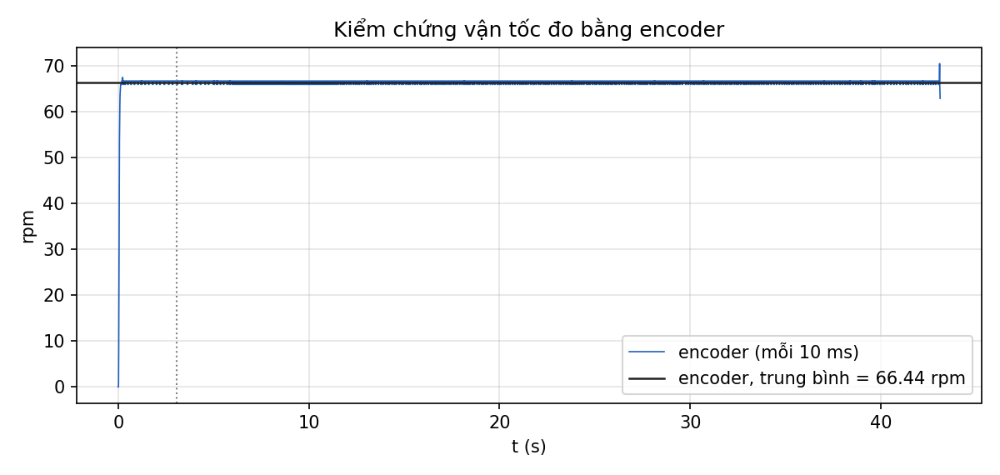

## 3. Nhận dạng đối tượng

Duty khởi động 4 %, v_max = 136.2 rpm, vận tốc đặt r = 75 rpm.

| Tham số FOPDT | Giá trị (TB ± độ lệch chuẩn, 3 lần) |
| --- | --- |
| K (rpm/%) | 1.3814 ± 0.0012 |
| T (ms) | 20.4 ± 6.5 |
| L (ms) | 17.5 ± 16.8 |

K từ đặc tính tĩnh quanh điểm làm việc: 1.3829 rpm/%.

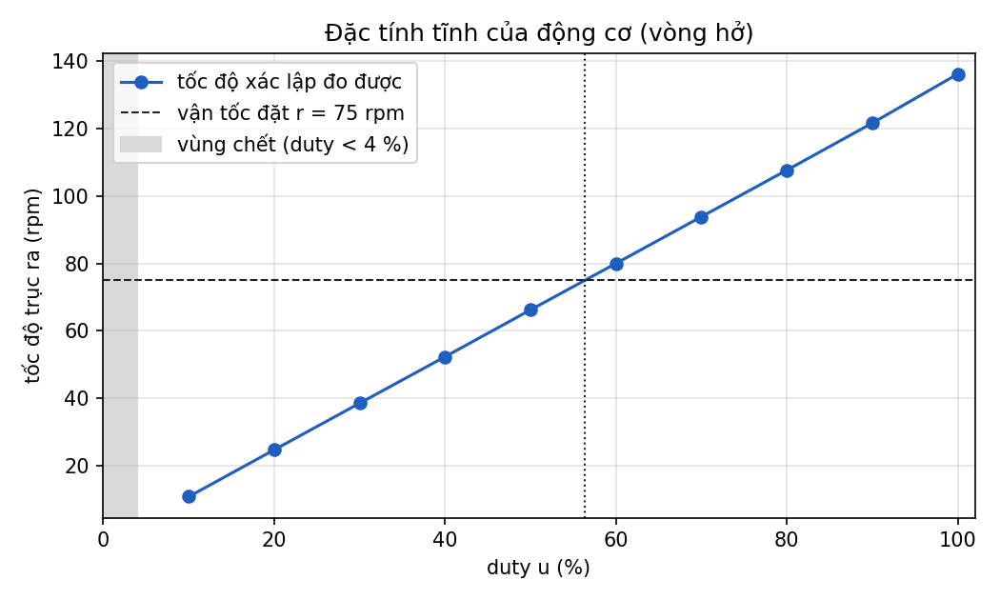

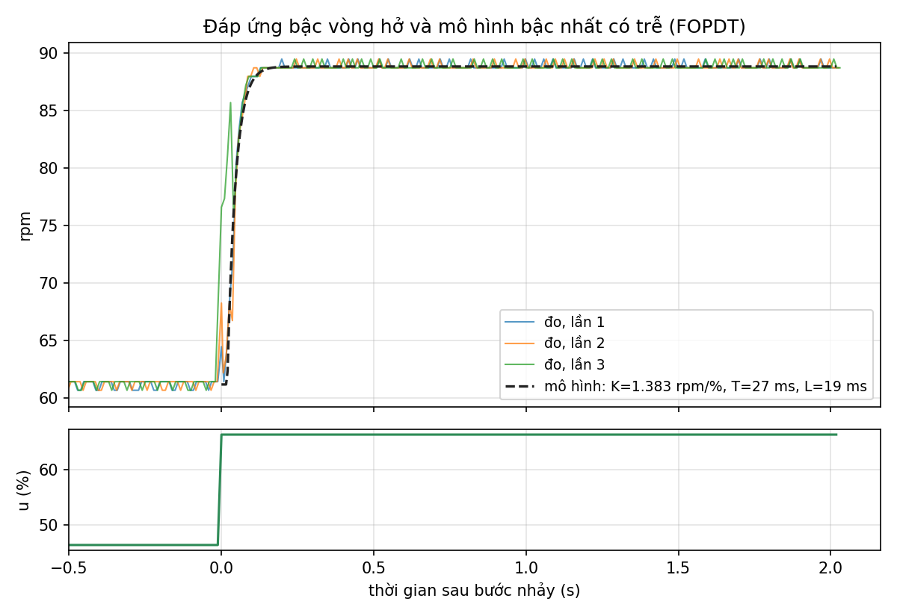

## 4. Tune PID

Tiêu chí ĐẠT (đề xuất, lab không quy định): POT ≤ 10 %, |e_ss| ≤ 2 %, t_s theo dải ±5 %, σ(u) ≤ 3 % duty.

| Lần thử | Kp | Ki | Kd | POT (%) | t_s (ms) | e_ss (%) | σ(u) (%) | Kết quả |
| --- | --- | --- | --- | --- | --- | --- | --- | --- |
| A1_ZN-P | 0.8445 | 0 | 0 | 36.0 | 124 | +47.98 | 0.3 | không đạt: POT > 10 %; |e_ss| > 2 % |
| A2_ZN-PI | 0.76 | 13.04 | 0 | 1.1 | 228 | +0.01 | 0.3 | ĐẠT |
| A3_ZN-PID | 1.013 | 28.97 | 0.008861 | 9.2 | 118 | +0.00 | 0.8 | ĐẠT |
| B1_tc41ms | 0.2534 | 12.42 | 0 | 1.1 | 107 | +0.00 | 0.1 | ĐẠT |
| B2_tc20ms | 0.3898 | 19.11 | 0 | 18.2 | 134 | -0.01 | 0.1 | không đạt: POT > 10 % |
| C1_Kp_x0.7 | 0.1774 | 12.42 | 0 | 2.1 | 110 | +0.00 | 0.1 | ĐẠT |
| C2_Kp_x1.4 | 0.3547 | 12.42 | 0 | 1.1 | 144 | +0.00 | 0.1 | ĐẠT |
| C3_Ki_x0.5 | 0.2534 | 6.21 | 0 | 1.1 | 360 | -0.01 | 0.1 | ĐẠT |
| C4_Ki_x2 | 0.2534 | 24.84 | 0 | 37.5 | 234 | +0.00 | 0.1 | không đạt: POT > 10 % |
| D1_P_only | 0.2534 | 0 | 0 | 10.0 | 91 | +77.04 | 0.1 | đối chứng |
| D2_PI_plus_D | 0.2534 | 12.42 | 0.002215 | 2.1 | 102 | -0.01 | 0.2 | ĐẠT |
| E1_final | 0.2534 | 12.42 | 0.002215 | 2.1 | 101 | -0.01 | 0.2 | đối chứng |
| E2_final | 0.2534 | 12.42 | 0.002215 | 1.1 | 119 | +0.00 | 0.1 | đối chứng |
| E3_final | 0.2534 | 12.42 | 0.002215 | 1.1 | 116 | +0.00 | 0.1 | đối chứng |

**Bộ hệ số chọn:** Kp = 0.2534, Ki = 12.42, Kd = 0.002215 (khâu D tính theo đầu ra đo).

| Chỉ tiêu (TB ± độ lệch chuẩn, 3 lần) | Giá trị |
| --- | --- |
| Độ vọt lố POT | 1.4 ± 0.6 % |
| Thời gian lên t_r (10–90 %) | 73 ± 7 ms |
| Thời gian xác lập t_s (±5 %) | 112 ± 10 ms |
| Sai số xác lập e_ss | +0.00 ± 0.01 % |
| IAE | 5.17 ± 0.07 rpm·s |

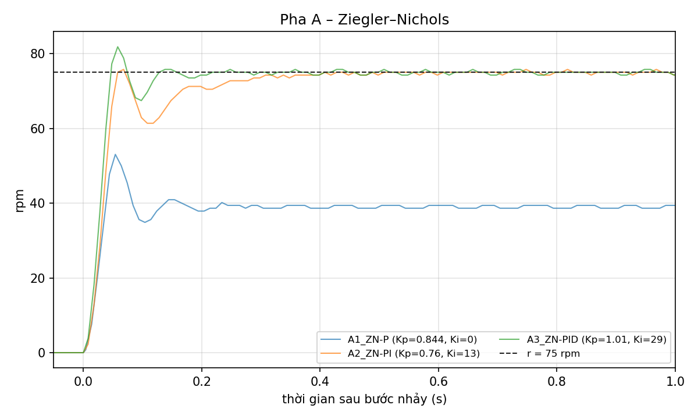

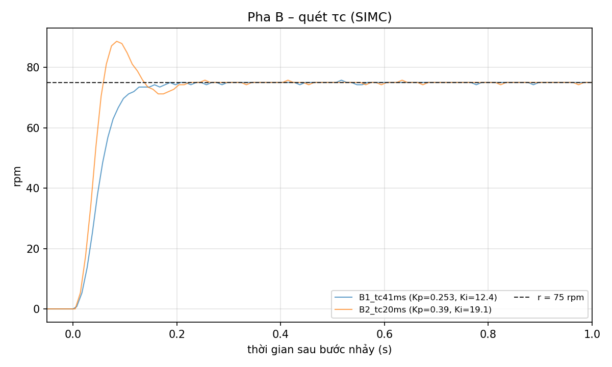

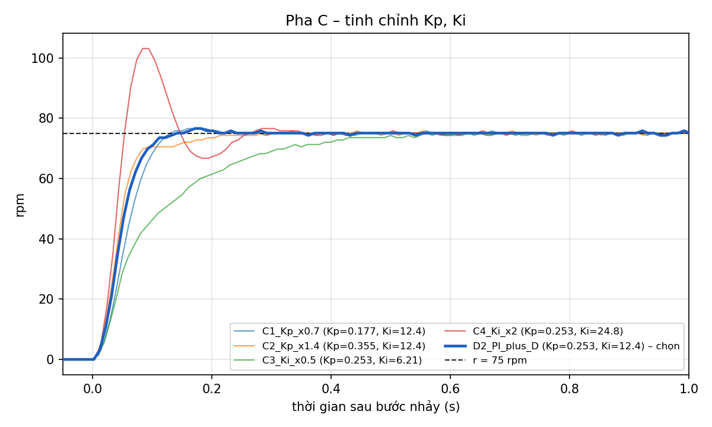

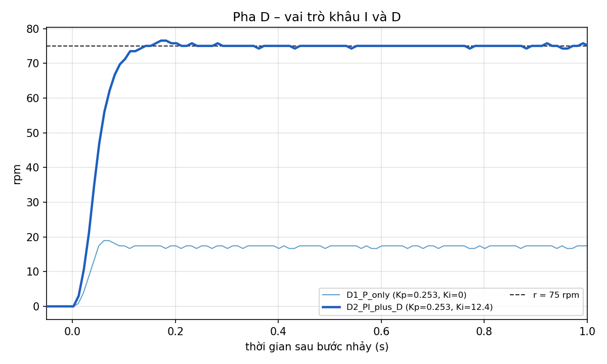

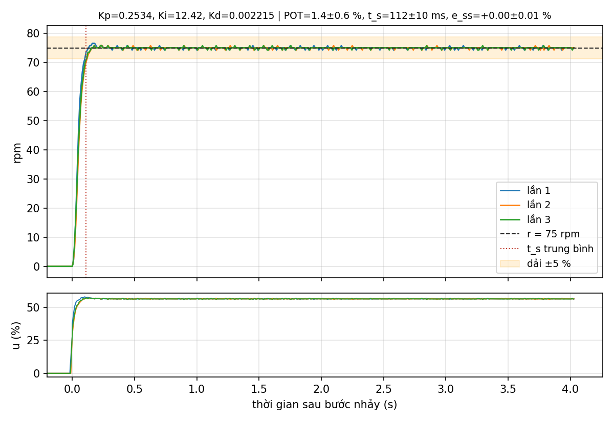

## 5. Thay đổi tải đột ngột

### 5.1 Cản tay (yêu cầu của lab)

| Lần | Sự kiện | t (s) | Lệch đỉnh (rpm) | Lệch đỉnh (%) | Phục hồi (ms) | u max (%) |
| --- | --- | --- | --- | --- | --- | --- |
| 1 | vọt lên (vừa thả) | 6.42 | +5.36 | +7.1 | 60 | 59.7 |
| 1 | giảm tốc (đang cản) | 8.39 | -6.77 | -9.0 | 90 | 65.3 |
| 1 | vọt lên (vừa thả) | 10.00 | +4.60 | +6.1 | 90 | 61.2 |
| 2 | vọt lên (vừa thả) | 6.43 | +6.11 | +8.1 | 90 | 61.0 |

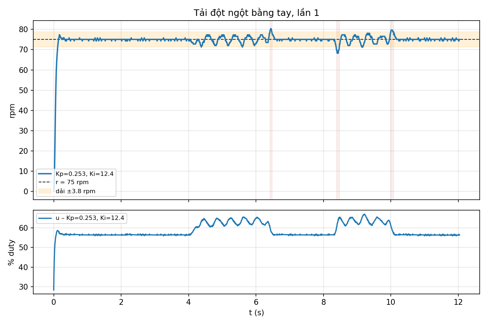

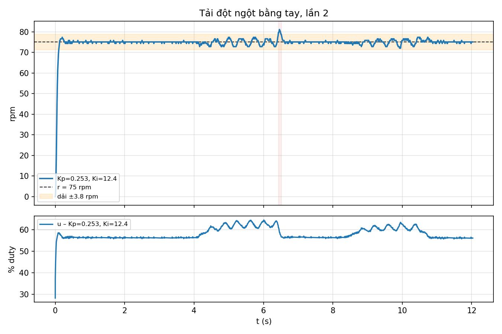

### 5.2 Tải tương đương bằng điện (d = 25 % duty)

| Bộ hệ số | Sự kiện | Lệch đỉnh (rpm) | Phục hồi (ms) | e cuối đoạn (rpm) | u cuối đoạn (%) |
| --- | --- | --- | --- | --- | --- |
| Đã tune | có tải | -21.18 | 158 | -0.01 | 81.3 |
| Đã tune | bỏ tải | +23.55 | 165 | -0.01 | 56.3 |
| Chỉ P (Ki = 0) | có tải | -75.00 | — | +75.00 | 19.0 |
| Chỉ P (Ki = 0) | bỏ tải | -75.00 | — | +57.80 | 14.6 |
| Ki giảm 4 lần | có tải | -23.45 | 597 | +0.01 | 81.3 |
| Ki giảm 4 lần | bỏ tải | +26.58 | 630 | -0.02 | 56.3 |

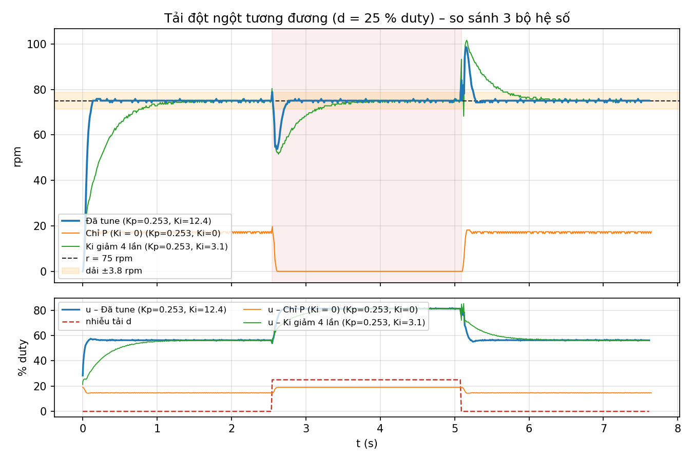

## 6. Áp dụng PID cho đồ án

(Dán đoạn 150–250 từ ở Bước 8 của tài liệu hướng dẫn vào đây.)
