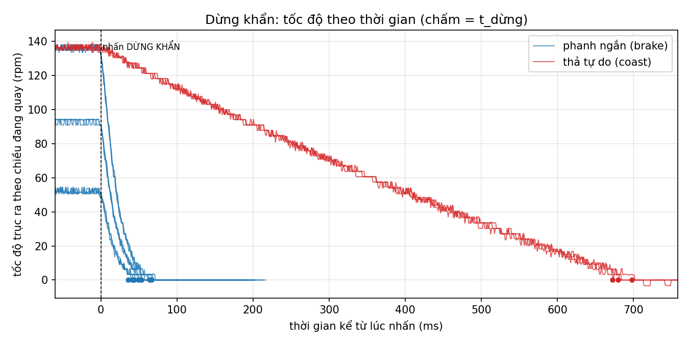
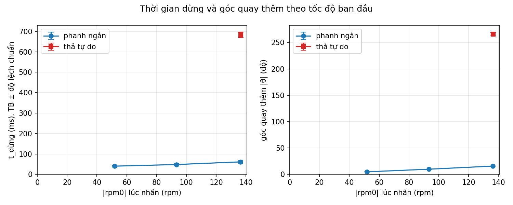
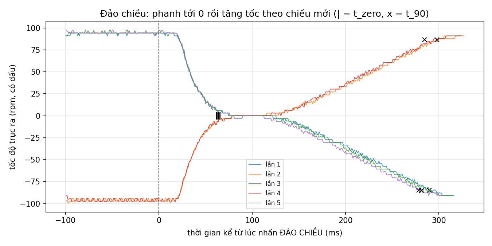

# Lab 4 – Nhánh Robot: đảo chiều và dừng khẩn cấp động cơ DC

Tạo tự động bởi `lab4.py report` lúc 2026-11-27 13:07. Số liệu lấy từ `logs`.

## 1. Yêu cầu

Theo Lab 4, phần Thực hành về nhà của nhánh Robot yêu cầu *“lập trình đảo chiều + dừng khẩn cấp động cơ theo tín hiệu nút nhấn, đo thời gian đáp ứng dừng khẩn”* và nộp code cùng video demo.

## 2. Phần cứng và đấu dây

| Khối | Kết nối |
| --- | --- |
| ESP32-DevKitC-32D → TB6612FNG | IO25 = PWMA, IO26 = AIN1, IO27 = AIN2, 3V3 = VCC và STBY, GND = GND |
| TB6612FNG → động cơ JGA25-370 | AO1 = dây đỏ (M+), AO2 = dây trắng (M−) |
| Encoder | xanh dương = 3V3, đen = GND, vàng (A) = IO32, xanh lá (B) = IO33 |
| Nguồn động cơ | adapter 12 V → VM và GND của TB6612, GND chung với ESP32 |
| Nút ĐẢO CHIỀU | IO18 ↔ GND (kéo lên nội) |
| Nút DỪNG KHẨN | IO19 ↔ GND (kéo lên nội, ngắt cạnh xuống) |

CPR = 1978.7 đếm/vòng trục ra (Lab 3 – hiệu chuẩn quay tay (lab3_config.json)).

Kiểm tra phần cứng (`lab4.py check`): nút DỪNG KHẨN đạt, nút ĐẢO CHIỀU đạt, reset bằng giữ nút đạt, encoder đạt (52.0 rpm ở duty 40 %, enc_err = 0), đảo chiều đạt, dừng khẩn đạt.

## 3. Nguyên lý điều khiển

Bảng chân lý của TB6612FNG (datasheet Toshiba) cho phép đổi chế độ chỉ bằng hai chân IN1 và IN2. Khi IN1 = IN2 = H thì driver vào chế độ **phanh ngắn** (hai đầu ra cùng nối GND) dù PWM ở mức nào. Khi IN1 = IN2 = L và PWM = H thì driver vào chế độ **stop**, hai đầu ra ở trạng thái trở kháng cao nên động cơ quay tự do. Firmware dùng điều này như sau:

- **Dừng khẩn:** nút nối IO19 gây ngắt cạnh xuống. Hàm ngắt ghi thẳng thanh ghi `GPIO_OUT_W1TS` để đặt IN1 = IN2 = H (phanh ngắn) trước khi làm bất cứ việc gì khác, sau đó **chốt** trạng thái. Vòng lặp chính không thể ghi đè đầu ra khi đã chốt. Muốn chạy lại thì phải nhả nút, giữ nút ĐẢO CHIỀU 1 s để xoá chốt, rồi nhấn ĐẢO CHIỀU thêm một lần nữa, nên việc xoá chốt không tự làm động cơ quay.
- **Đảo chiều:** không đổi chiều đột ngột khi trục đang quay. Firmware phanh ngắn tới khi trục đứng yên (không dịch chuyển trong 30 ms), rồi mới đổi IN1/IN2 và tăng duty dần (ramp 400 %/s).

## 4. Phương pháp đo

Mốc t = 0 là lúc vào hàm ngắt của nút DỪNG KHẨN, đo bằng `esp_timer` với độ phân giải 1 µs. Encoder đếm x4 bằng ngắt. Ngoài ra firmware ghi (thời gian, số đếm) mỗi 1 ms, giữ 100 ms trước sự kiện và gửi lên PC sau khi trục dừng.

- **t_dừng**: lần cuối trục dịch chuyển ≥ 2 đếm so với mốc trước, tức ≈ 0.36° trục ra. Ngưỡng 2 đếm giúp bỏ qua rung ±1 đếm của encoder khi trục đứng yên. Trục được coi là đã dừng khi không dịch chuyển trong 150 ms. Firmware tính giá trị này theo thời gian thực trong ngắt encoder, còn PC tính lại bằng đúng thuật toán đó trên dữ liệu 1 kHz để đối chiếu.
- **t_10%**: lần đầu |tốc độ| ≤ 10 % tốc độ lúc nhấn. Tốc độ được tính bằng sai phân trung tâm ±2 ms để không làm nhoè thời điểm, còn tốc độ lúc nhấn là trung bình trong [−50, −5] ms với cửa sổ ±5 ms.
- **θ**: góc trục ra quay thêm từ lúc nhấn tới lúc dừng. **τ**: hằng số thời gian khi hãm, ước lượng bằng hồi quy ln|ω| theo t trong khoảng [0, t_10%].
- **Không đo được** độ trễ từ lúc tiếp điểm nút đóng tới lúc vào ngắt, vì muốn đo phải có máy hiện sóng. Vì vậy t_dừng ở đây tính từ lúc ESP32 nhận ngắt.

## 5. Kết quả dừng khẩn

Phiên đo: `logs/estop/20261127_130555` (12 lần, nguồn kích: btn).

### 5.1. Tổng hợp (trung bình ± độ lệch chuẩn)

| Chế độ | Duty (%) | n | rpm lúc nhấn | t_dừng (ms) | t_10% (ms) | θ (°) | τ (ms) |
| --- | --- | --- | --- | --- | --- | --- | --- |
| phanh ngắn | 40 | 3 | 51.9 | 40.2 ± 4.0 | 32.9 ± 2.0 | 4.8 ± 0.0 | 15.1 |
| phanh ngắn | 70 | 3 | 93.4 | 48.2 ± 5.5 | 38.5 ± 2.1 | 9.8 ± 0.1 | 16.5 |
| phanh ngắn | 100 | 3 | 136.2 | 61.1 ± 7.2 | 40.8 ± 1.1 | 15.7 ± 0.1 | 17.9 |
| thả tự do | 100 | 3 | 136.4 | 683.4 ± 13.1 | 588.4 ± 12.3 | 266.0 ± 3.3 | 322.6 |

Ở cùng duty 100 %, phanh ngắn dừng trục sau 61.1 ms còn thả tự do mất 683.4 ms, tức chậm hơn 11.2 lần. Góc quay thêm tương ứng là 15.7° và 266.0°. Kết quả này là lý do firmware chọn phanh ngắn làm chế độ dừng khẩn mặc định.

### 5.2. Từng lần đo, đối chiếu firmware và PC

| Lần | Chế độ | Duty | Nguồn | rpm lúc nhấn | t_dừng PC (ms) | t_dừng firmware (ms) | Lệch (ms) | t_10% (ms) | θ (°) |
| --- | --- | --- | --- | --- | --- | --- | --- | --- | --- |
| 01_brake_d40 | brake | 40 | btn | 52.0 | 43.7 | 42.9 | +0.7 | 31.7 | 4.8 |
| 02_brake_d40 | brake | 40 | btn | 52.0 | 41.3 | 41.2 | +0.1 | 35.3 | 4.8 |
| 03_brake_d40 | brake | 40 | btn | 51.6 | 35.8 | 35.4 | +0.4 | 31.8 | 4.9 |
| 04_brake_d70 | brake | 70 | btn | 93.4 | 53.1 | 53.0 | +0.1 | 36.1 | 9.7 |
| 05_brake_d70 | brake | 70 | btn | 93.3 | 42.3 | 42.1 | +0.2 | 39.3 | 9.8 |
| 06_brake_d70 | brake | 70 | btn | 93.4 | 49.2 | 48.9 | +0.3 | 40.2 | 9.9 |
| 07_brake_d100 | brake | 100 | btn | 135.7 | 53.0 | 52.2 | +0.7 | 42.0 | 15.6 |
| 08_brake_d100 | brake | 100 | btn | 136.4 | 63.8 | 63.7 | +0.1 | 40.8 | 15.7 |
| 09_brake_d100 | brake | 100 | btn | 136.3 | 66.7 | 65.8 | +0.9 | 39.7 | 15.8 |
| 10_coast_d100 | coast | 100 | btn | 136.2 | 679.5 | 678.8 | +0.7 | 574.5 | 262.2 |
| 11_coast_d100 | coast | 100 | btn | 136.4 | 697.9 | 697.3 | +0.7 | 597.9 | 268.5 |
| 12_coast_d100 | coast | 100 | btn | 136.5 | 672.7 | 671.7 | +0.9 | 592.7 | 267.2 |

Độ lệch lớn nhất giữa hai cách tính t_dừng là 0.9 ms. Hai cách dùng cùng định nghĩa nhưng PC chỉ có mẫu 1 ms, nên độ lệch dưới khoảng 1–2 ms là bình thường.

## 6. Kết quả đảo chiều

Phiên đo: `logs/reverse/20261127_130650` (5 lần ở duty 70 %, nguồn kích: btn).

t = 0 là cạnh nhấn đầu tiên của nút. Firmware chỉ hành động sau khi nút ổn định 20 ms để chống dội phím, nên t_zero và t_90 đã bao gồm khoảng 20 ms này. Với dừng khẩn thì không có khoảng trễ này, vì ngắt hành động ngay ở cạnh đầu tiên.

| Lần | rpm trước | rpm cuối bản ghi | t_zero (ms) | t_90 (ms) |
| --- | --- | --- | --- | --- |
| 01_rev_d70 | +94.0 | -83.2 | 65.7 | 289.7 |
| 02_rev_d70 | -96.2 | +85.6 | 61.7 | 297.7 |
| 03_rev_d70 | +94.3 | -84.3 | 65.2 | 278.2 |
| 04_rev_d70 | -96.2 | +85.9 | 62.6 | 284.6 |
| 05_rev_d70 | +94.5 | -83.2 | 64.0 | 281.0 |
| **TB ± ĐLC** | | | **63.9 ± 1.7** | **286.3 ± 7.7** |

## 7. Giới hạn

- Nút nhấn thường hở (NO) nên không an toàn khi đứt dây, vì đứt dây thì nhấn nút cũng không gây dừng. Dừng khẩn công nghiệp dùng tiếp điểm thường đóng (NC) và cắt nguồn động lực bằng phần cứng. Bài này chỉ minh hoạ nguyên lý bằng phần mềm.
- Thời gian dừng phụ thuộc tải và quán tính gắn trên trục. Số đo ở đây ứng với trục ra không tải.
- Chế độ thả tự do được đặt trong ngắt bằng IN1 = IN2 = L. PWM chỉ được đưa về H ở vòng lặp kế tiếp, vì `ledcWrite` không gọi an toàn trong ngắt.

